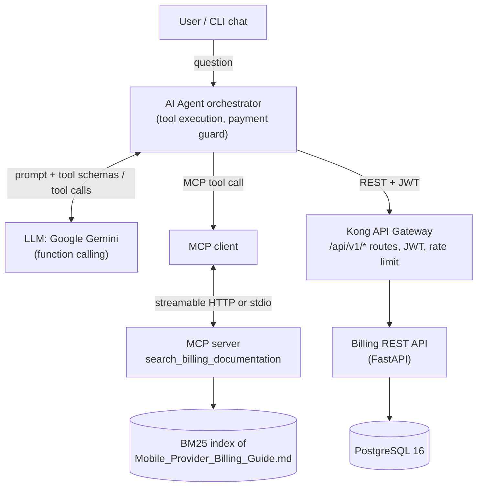
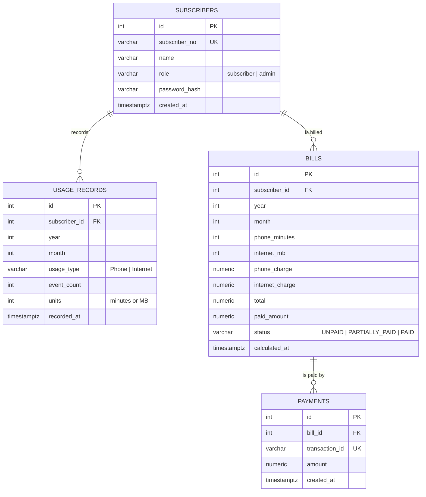

# AI Billing Support Assistant — SE 4458 Midterm 1 (Group 2)

**Student:** Ceren Bilgenoğlu · **Course:** SE 4458 Software Architecture & Design of Modern Large Scale Systems

A conversational assistant for mobile subscribers. A Gemini LLM chooses tools with real function
calling; the agent runs them against an **MCP server** (indexed billing guide) and the **Billing REST
API** (reached only through a **Kong API Gateway**), sends the results back to the LLM and returns a
grounded answer that cites guide sections.

| | |
|---|---|
| Gateway URL (Azure) | `http://172.213.13.11:8000` |
| Swagger UI | `http://172.213.13.11:8000/api/v1/docs` |
| OpenAPI spec | `http://172.213.13.11:8000/api/v1/openapi.json` (also committed: [`docs/openapi.json`](docs/openapi.json)) |
| Demo video | __VIDEO_LINK__ |

---

## Contents
1. [Architecture](#1-architecture)
2. [Repository layout](#2-repository-layout)
3. [Run it](#3-run-it)
4. [REST API](#4-rest-api)
5. [API Gateway](#5-api-gateway-kong)
6. [Authentication and authorization](#6-authentication-and-authorization)
7. [Database and ER model](#7-database-and-er-model)
8. [MCP server and indexing](#8-mcp-server-and-indexing)
9. [AI agent](#9-ai-agent)
10. [Demo evidence](#10-demo-evidence)
11. [Unit tests](#11-unit-tests)
12. [Cloud deployment (Azure)](#12-cloud-deployment-azure)
13. [Assumptions and design decisions](#13-assumptions-and-design-decisions)
14. [LLM cost](#14-llm-cost)

---

## 1. Architecture



* The **LLM never calls a backend**. It only proposes tool calls; the agent executes them and sends
  the results back for the final answer.
* The **MCP path is separate** from the gateway path, as required.
* Every REST call — including the agent's — goes through Kong. The billing API container has no
  published port.

Agent execution flow: user question → LLM tool selection → agent executes MCP and/or REST (via
gateway) → tool results returned to LLM → grounded answer with guide section references.

## 2. Repository layout

| Path | What it is |
|---|---|
| `billing_api/` | FastAPI service: 5 billing operations + token endpoint, SQLAlchemy models, business rules (`app/billing.py`), 64 unit tests |
| `mcp_server/` | MCP server (official `mcp` Python SDK), section chunker + BM25 index, 25 tests |
| `agent/` | LLM agent: Gemini adapter, MCP client, gateway client, payment-confirmation guard, CLI, 19 tests |
| `gateway/kong.template.yml` | Kong 3.9 declarative config (routes, JWT, plugins) |
| `docker-compose.yml` | PostgreSQL + API + MCP + Kong (+ agent CLI) |
| `deploy/cloud-init.yml` | Azure VM bootstrap used for the cloud deployment |
| `docs/` | OpenAPI spec, ER diagram, demo traces and screenshots |
| `run_tests.sh` | Runs all test suites |

## 3. Run it

### Locally with Docker (whole system)

```bash
cp .env.example .env          # fill JWT_SECRET, POSTGRES_PASSWORD (openssl rand -hex 32), GEMINI_API_KEY
docker compose up -d --build
docker compose exec billing-api python -m app.seed     # demo users and bills
docker compose run --rm agent                           # chat (asks for subscriber no + password)
```

Gateway: `http://localhost:8000` · Swagger: `http://localhost:8000/api/v1/docs`

### Test data (created by `python -m app.seed`)

| Subscriber | Password | Role | Data |
|---|---|---|---|
| `5551001` | `ayse123` | subscriber | Oct 2026: 1,350 min + 35,000 MB → **$80**, unpaid · Sep 2026: 800 min + 15,000 MB → $50, $20 paid |
| `5551002` | `mehmet123` | subscriber | Oct 2026: 500 min + 22,000 MB → **$60**, unpaid |
| `ADMIN` | `admin123` | admin | can call Add Usage and Calculate Bill, can read any bill |

These are demo credentials for a fictitious system.

### Reproduce the results (instructor checklist)

```bash
G=http://172.213.13.11:8000        # or http://localhost:8000

# 1. public route (no token)
curl $G/api/v1/bills/5551001/2026/10

# 2. protected route without token -> 401 from the gateway
curl -i $G/api/v1/bills/5551001/2026/10/detailed

# 3. get a token and call the protected route
TOKEN=$(curl -s -X POST $G/api/v1/auth/token -H 'Content-Type: application/json' \
  -d '{"subscriberNo":"5551001","password":"ayse123"}' | python3 -c 'import sys,json;print(json.load(sys.stdin)["accessToken"])')
curl -H "Authorization: Bearer $TOKEN" "$G/api/v1/bills/5551001/2026/10/detailed?page=1&pageSize=5"

# 4. another subscriber's bill with this token -> 403 from the API
curl -i -H "Authorization: Bearer $TOKEN" $G/api/v1/bills/5551002/2026/10/detailed

# 5. the three MCP retrieval queries (real MCP client -> MCP server)
cd mcp_server && pip install -r requirements.txt && python demo_queries.py

# 6. agent scenarios: docker compose run --rm agent   (or: cd agent && python -m agent.cli)
```

## 4. REST API

Base path **`/api/v1`** (versioned). Interactive docs: Swagger UI at `/api/v1/docs`. Every error has
one shape: `{"error": {"code": "...", "message": "..."}}`.

| Operation | Method & path | Auth (assignment table) | Paging | Who may call |
|---|---|---|---|---|
| Get token | `POST /api/v1/auth/token` | – | – | anyone |
| Add Usage | `POST /api/v1/usage` | **YES** | NO | admin |
| Calculate Bill | `POST /api/v1/bills/calculate` | **YES** | NO | admin |
| Query Bill | `GET /api/v1/bills/{subscriberNo}/{year}/{month}` | **NO** | NO | anyone |
| Query Bill Detailed | `GET /api/v1/bills/{subscriberNo}/{year}/{month}/detailed?page=&pageSize=` | **YES** | **YES** | owner or admin |
| Pay Bill | `POST /api/v1/payments` | **YES** | NO | owner or admin |

Business rules (guide §2–§5, implemented in `billing_api/app/billing.py` with integer arithmetic):

* Phone: first 1,000 minutes free, then **$10 per started 1,000-minute block**.
* Internet: **$50 up to 20 GB** (also for zero usage), then **$10 per started 10 GB block**; 1 GB = 1,000 MB.
* Total = phone + internet; no taxes or fees. Example: 1,350 min + 35 GB = $10 + $70 = **$80**.
* Add Usage: one Phone event = 10 minutes, one Internet event = 1 MB (`count` records several events).
* Pay Bill: partial or full; **duplicate `transactionId` → 409**, **amount above remaining balance → 400**,
  already paid → 409. Status `UNPAID` → `PARTIALLY_PAID` → `PAID`.
* Due date = 15 days after month end (returned by Query Bill Detailed).

Status codes used: 200/201 success · 400 business rule · 401 no/invalid token · 403 role or ownership ·
404 subscriber/bill not found · 409 conflict · 422 validation.

## 5. API Gateway (Kong)

Kong 3.9 in DB-less mode, config: [`gateway/kong.template.yml`](gateway/kong.template.yml).
Public URL: **`http://172.213.13.11:8000`**. Paths are forwarded unchanged (`strip_path: false`) to
`http://billing-api:8000`, so a future `/api/v2` can be routed to a new service without touching v1.

| Kong route | Method | Public path | Gateway auth |
|---|---|---|---|
| `auth-token-v1` | POST | `/api/v1/auth/token` | – |
| `query-bill-v1` | GET | `/api/v1/bills/{no}/{year}/{month}` | – (assignment: Query Bill = no auth) |
| `api-docs-v1` | GET | `/api/v1/docs`, `/api/v1/openapi.json` | – |
| `query-bill-detailed-v1` | GET | `/api/v1/bills/{no}/{year}/{month}/detailed` | **JWT** |
| `pay-bill-v1` | POST | `/api/v1/payments` | **JWT** |
| `calculate-bill-v1` | POST | `/api/v1/bills/calculate` | **JWT** |
| `add-usage-v1` | POST | `/api/v1/usage` | **JWT** |

Global plugins: `correlation-id` (`X-Request-ID` on every response) and a protective
`rate-limiting` ceiling (120 requests/minute per client). Group 2 has no business rate limit.

**Error response examples**

```http
GET /api/v1/bills/5551001/2026/10/detailed          (no token — rejected by Kong)
HTTP/1.1 401 Unauthorized
{"message":"Unauthorized"}

GET /api/v1/bills/5551002/2026/10/detailed          (Ayşe's valid token — rejected by the API)
HTTP/1.1 403 Forbidden
{"error":{"code":"FORBIDDEN","message":"You are not allowed to access another subscriber's data."}}

GET /api/v2/bills/5551001/2026/10                   (unknown version — no route)
HTTP/1.1 404 Not Found
{"message":"no Route matched with those values"}
```

__GATEWAY_EVIDENCE__

## 6. Authentication and authorization

* **JWT (HS256)** issued by `POST /api/v1/auth/token`; claims `iss`, `sub` (subscriber no), `role`
  (`subscriber`|`admin`), `iat`, `exp` (60 min). Passwords are stored as PBKDF2-SHA256 hashes.
* **Two layers:** Kong's `jwt` plugin checks signature and expiry on protected routes; the API checks
  them again and enforces **role** (Add Usage / Calculate Bill = admin) and **ownership** (a
  subscriber can only read or pay their own bill).
* **Agent identity:** the chat user logs in first. Agent tools have **no subscriber-number
  parameter**; every call uses the logged-in user's number and token. Typing someone else's number
  in the chat cannot reach their data (tested: `test_subscriber_number_in_prompt_cannot_reach_other_accounts`).
* **Payment confirmation** is enforced in code (see §9).
* Secrets (`JWT_SECRET`, DB password, Gemini key) come from `.env`, which is git-ignored.

## 7. Database and ER model

PostgreSQL 16 (server database). Tables are created by SQLAlchemy on API start-up.



Constraints: `bills (subscriber_id, year, month)` unique — one bill per period; `payments.transaction_id`
unique — the database itself rejects duplicate payments; money is `NUMERIC(12,2)`.

## 8. MCP server and indexing

* **Server:** `mcp_server/server.py`, official MCP Python SDK (`FastMCP`), transports stdio and
  streamable HTTP (`/mcp`). Deployed as its own container.
* **Tool schema**

```json
{
  "name": "search_billing_documentation",
  "description": "Search the Mobile Provider Billing Guide ... for POLICY and PRICING ... It does NOT contain any subscriber's usage, bill totals or payments.",
  "inputSchema": {
    "type": "object",
    "properties": {
      "query": {"type": "string"},
      "max_results": {"type": "integer", "default": 3}
    },
    "required": ["query"]
  }
}
```

  Result: `{"document", "documentId", "query", "matches": [{"section", "heading", "text", "score"}]}`
  — e.g. `{"section": "3.2", "heading": "Additional internet blocks", "text": "Each additional 10 GB block costs $10 ..."}`.

* **Indexing approach** (`mcp_server/indexer.py`), done **once before queries** — at Docker image build
  (`build_index.py`) or at server start; never per question. The index is reused while the document's
  SHA-256 is unchanged and rebuilt automatically when it changes.
  1. **Chunking:** one chunk per numbered section (`2.1`, `3.2`, … `9`) → 26 chunks, so every hit
     carries an exact section reference.
  2. **Analysis:** lower-case, stop-word removal, Snowball stemming (charge/charges/charged → `charg`).
     Heading words count ×3.
  3. **Ranking:** Okapi BM25 (k1 = 1.5, b = 0.75) over an inverted index saved as JSON.
  4. **Query expansion:** small billing synonym list (extra → additional, data → internet, …).
  Full-text search was chosen over embeddings: no external model, deterministic, free.

* **Three distinct retrieval queries** — `python mcp_server/demo_queries.py` (real MCP client):

__MCP_DEMO__

## 9. AI agent

* `agent/agent/core.py` (orchestrator), `llm.py` (Gemini adapter), `backends.py` (gateway + MCP
  clients), `cli.py` (chat with tool trace).
* **LLM:** Google Gemini (`gemini-3.8-flash`, with fallback to `gemini-3.5-flash` and `gemini-3.1-flash-lite` when a model is overloaded or retired; set by `GEMINI_MODEL`) through `google-genai`, automatic function
  calling **disabled** — the model only proposes calls. The LLM layer is provider-neutral; tests use a
  scripted fake LLM.
* **Tools given to the LLM:** `search_billing_documentation` (MCP), `query_bill`,
  `query_bill_detailed`, `pay_bill` (REST via gateway). No keyword routing: the LLM decides.
* **Payment guard (in code, not only in the prompt):** `pay_bill` never pays. It stores a pending
  payment (with a fresh transaction ID) and returns `CONFIRMATION_REQUIRED`. The Pay Bill API is called
  **only if the user's next message is an explicit "yes"/"evet"/"confirm"**; any other reply cancels it.
  A network retry reuses the same transaction ID, so it cannot double-pay. The API result is given back
  to the LLM, which may report success only when the API says `SUCCESS`.
* **Tool trace:** every step (LLM call, MCP call, REST call, guard decision) is printed with input,
  output and duration and saved to `agent/traces/session-*.jsonl`.

## 10. Demo evidence

__DEMO_EVIDENCE__

## 11. Unit tests

Automated tests for every REST operation (≥1 success and ≥1 failure/edge case each), the billing rules,
the MCP indexer/server and the agent. **No cloud, no database server, no Docker and no LLM key are
needed**: the API tests use an in-memory SQLite database only as a test double, the MCP tests start the
real server over stdio, and the agent tests use a scripted fake LLM against the in-process API and the
real MCP server.

```bash
pip install -r agent/requirements-dev.txt     # installs everything for the three suites
./run_tests.sh                                # or: cd billing_api && python -m pytest -v
```

| Suite | Tests | Covers |
|---|---|---|
| `billing_api` | 64 | pricing rules & block rounding, every endpoint success + failure, auth (missing/expired/forged token), ownership, paging, duplicate transaction, overpayment |
| `mcp_server` | 25 | chunking, section ids, retrieval relevance, stemming/synonyms, index persistence ("index once"), MCP tool schema and calls over stdio |
| `agent` | 19 | MCP-only / REST-only / combined scenarios, payment only after "yes", cancel on other reply, retry idempotency, no access to other subscribers, error handling, Gemini message translation and model fallback |

__TEST_EVIDENCE__

## 12. Cloud deployment (Azure)

Everything runs on one **Azure VM** (Azure for Students subscription, region Italy North,
`Standard_B2ats_v2`, Ubuntu 24.04) with Docker Compose: PostgreSQL, billing API, MCP server and Kong.
Only port 8000 (Kong) and 22 (SSH) are open; the API, MCP server and database are reachable only inside
the Docker network.

Reproduce from Azure Cloud Shell:

```bash
az group create -n se4458-rg -l italynorth
az vm create -g se4458-rg -n billing-vm --image Canonical:ubuntu-24_04-lts:server:latest \
  --size Standard_B2ats_v2 --admin-username azureuser --generate-ssh-keys \
  --custom-data deploy/cloud-init.yml --public-ip-sku Standard
az vm open-port -g se4458-rg -n billing-vm --port 8000 --priority 1010
```

`deploy/cloud-init.yml` installs Docker, clones this repository, generates random secrets into `.env`,
runs `docker compose up -d --build` and seeds the demo data. To use the agent on the VM, add
`GEMINI_API_KEY` to `/opt/billing/.env` and run `docker compose run --rm agent`.

**Cost:** the VM size is in the Azure for Students free-services list; the public IP and disk are
covered by the student credit. Stop the VM (`az vm deallocate -g se4458-rg -n billing-vm`) when not
demoing.

## 13. Assumptions and design decisions

* **Billing rounding:** usage is kept as integers (minutes, MB) and blocks are computed with integer
  ceiling division, so 20,001 MB = 1 extra block ($60). Money is `Decimal`/`NUMERIC(12,2)`.
* **Bill lifecycle:** a bill exists only after Calculate Bill. Recalculation is allowed until the first
  payment; after that it returns `409 BILL_LOCKED` so a paid amount never exceeds a changed total.
* **Add Usage `count`:** the assignment defines one call = 10 minutes or 1 MB. An optional `count`
  (default 1) records several events in one call; otherwise 35 GB would need 35,000 calls.
* **Query Bill without auth:** follows the assignment table. To avoid account enumeration, "unknown
  subscriber" and "bill not calculated" return the same `404 BILL_NOT_FOUND`. The agent still only
  queries the logged-in user's own number.
* **Roles:** `admin` (provider back office) may add usage, calculate bills and read/pay any bill;
  `subscriber` only their own.
* **Policy interpretation:** the guide is the source for rules; the API is the source for numbers. The
  agent is told never to present its own estimate as a stored bill (guide §4.4) and that there is no
  Dispute API (it explains the §7 process only).
* **Months without a year** ("my October bill") mean the most recent such month on or before today.
* **Confirmation words:** yes, y, confirm, confirmed, evet, onaylıyorum (exact reply). Anything else
  cancels the prepared payment.
* **API style:** REST/JSON with FastAPI; OpenAPI 3.1 generated from code.
* **MCP SDK:** pinned to `mcp>=1.9,<2` (the 2.x line renamed FastMCP and changed APIs).
* **Test database:** unit tests use SQLite in memory only as a test double; the deployed system uses
  PostgreSQL (the server-database requirement).
* **Deployment:** a single VM with Docker Compose was chosen over managed services for cost (student
  credit) and reproducibility (same compose file locally and in the cloud).

## 14. LLM cost

Gemini API **free tier** (Google AI Studio key, no billing account linked) → **$0**. Free-tier limits
are low, so the adapter retries 429 responses with back-off. A typical question uses 1–3 LLM calls of
about 1–2k input tokens; the CLI prints the session's token usage on exit. Low-cost testing: all unit
tests use a scripted fake LLM, so no key and no quota are needed to verify the system.
